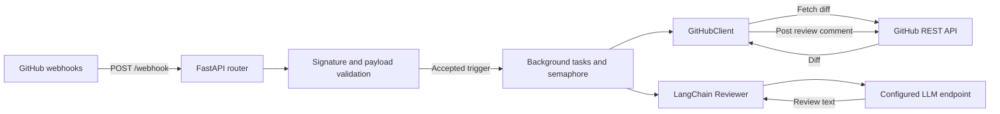
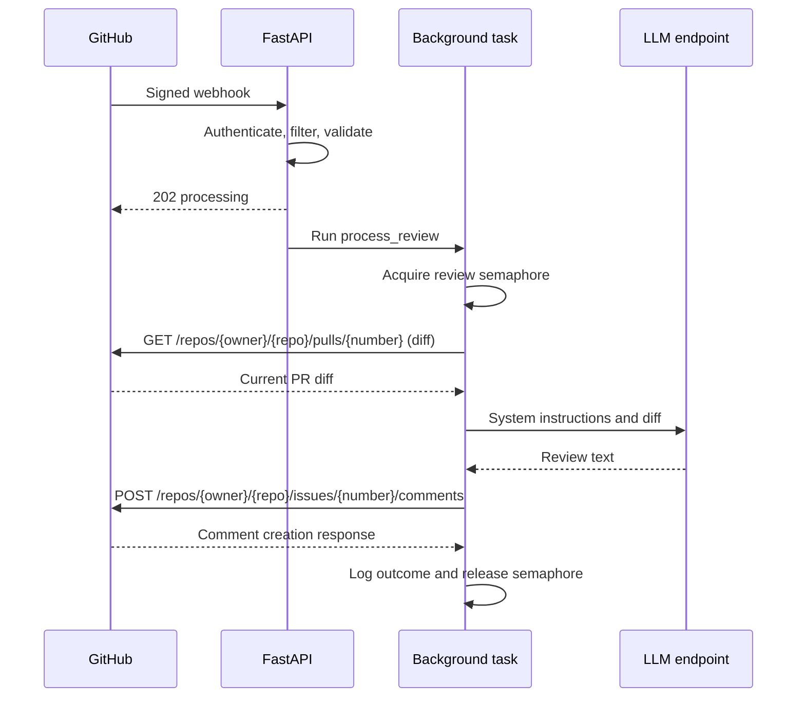

# Architecture

The bot is a single Python ASGI service. FastAPI receives signed GitHub webhook
requests, selects review events, and schedules background work. Each review fetches
a PR diff from GitHub, sends it through a LangChain prompt and model, and posts a
Markdown conversation comment on the PR. The service has no database or external
job queue.

## Components



| Module | Responsibility |
| --- | --- |
| [`app/main.py`](../app/main.py) | App factory, lifespan, payload models, routes, trigger selection, background orchestration, and review logging |
| [`app/config.py`](../app/config.py) | Pydantic settings, environment loading, validation, and provider defaults |
| [`app/security.py`](../app/security.py) | HMAC SHA-256 signature verification using raw request bytes |
| [`app/github_client.py`](../app/github_client.py) | Async diff retrieval, diff size enforcement, and comment creation |
| [`app/reviewer.py`](../app/reviewer.py) | Prompt construction, ChatOpenAI configuration, async chain execution, and output limits |

## Startup and resource ownership

Importing `app.config` creates the singleton `settings` object. Environment
variables override values from `.env`; missing required secrets or invalid settings
prevent startup. Validation checks configuration shape, not whether credentials
work with a remote service.

`create_app(config)` builds the FastAPI application. Its lifespan creates a shared
`httpx.AsyncClient` for GitHub, a `Reviewer`, and an `asyncio.Semaphore`, storing
them on `app.state`. The HTTP client closes when the lifespan ends. No GitHub or
LLM request is required to complete startup.

`python -m app.main` starts Uvicorn using `HOST` and `PORT`. `GET /health` returns
`{"status":"ok"}`; it does not test credentials, provider connectivity, queue
backlog, or the ability to post a comment.

## Webhook intake

`POST /webhook` processes requests in this order:

1. Read the raw body while enforcing `MAX_WEBHOOK_BYTES`.
2. Verify `X-Hub-Signature-256` against an HMAC of those bytes using
   `WEBHOOK_SECRET` and a constant time comparison.
3. Require `X-GitHub-Event`. Ignore events other than `pull_request` and
   `issue_comment`.
4. Parse supported-event bodies as JSON objects and select the event action.
5. Validate relevant fields with Pydantic, including repository path syntax and
   positive integer PR numbers. Automatic PR events must contain matching
   top-level and nested PR numbers.
6. Schedule `process_review` using FastAPI `BackgroundTasks` and respond with
   HTTP 202 and `{"status":"processing"}`.

Authentication runs before event filtering. Unsupported but correctly signed
events receive HTTP 202 with `{"status":"ignored"}`. An accepted response
acknowledges scheduling; it does not mean a review has completed successfully.

| Condition | HTTP response |
| --- | --- |
| Body exceeds the configured size | 413 |
| Missing or invalid signature | 401 |
| Missing event header, invalid JSON, or JSON that is not an object | 400 |
| Invalid fields for a supported action | 422 |
| Accepted review or ignored delivery | 202 |

Invalid JSON is checked only for supported event types. Payload fields are
validated only after action filtering, so ignored actions do not require a complete
PR or comment payload.

## Review triggers

| Event | Conditions for scheduling a review |
| --- | --- |
| `pull_request` | `AUTO_REVIEW=true` and action is `opened` or `synchronize` |
| `issue_comment` | Action is `created`, the issue has a non-null `pull_request` object, its state is `open`, the comment author's type is `User`, and the trimmed comment body equals `/review` |

The `/review` command is case-sensitive and must occupy the entire comment after
surrounding whitespace is removed. Edited comments, ordinary issues, bot comments,
and inline review comments do not trigger it. The webhook must subscribe to
**Issue comments** for commands and **Pull requests** for automatic reviews.
`AUTO_REVIEW=false` disables automatic triggers while leaving `/review` available.

Any human who can comment on an open PR can invoke the command. There is no
additional collaborator permission check or repository allowlist. The open-state
check uses the webhook payload; it is not rechecked before posting.

## Review pipeline



The semaphore bounds active pipelines per process with
`MAX_CONCURRENT_REVIEWS`. Waiting tasks remain in memory.

`GitHubClient.fetch_diff` streams the diff with
`Accept: application/vnd.github.v3.diff`. It rejects a diff once the accumulated
bytes exceed `MAX_DIFF_BYTES`; it does not review a partial diff. Empty diffs are
skipped. The limit measures bytes, so it does not guarantee that input fits a
particular model's context window.

`Reviewer` builds this LangChain runnable sequence:

```text
ChatPromptTemplate → ChatOpenAI → StrOutputParser
```

The system message asks for a Principal Software Engineer's review of correctness,
security, performance, and maintainability. The diff is inserted into a separate
human message as untrusted content. `ainvoke` runs the chain asynchronously.
The prompt requests `Critical Issues`, `Suggestions`, and `Positive Notes`
headings, but the service does not validate that structure. Empty output fails;
nonempty output is stripped and cut to 12000 characters, which can cut Markdown
formatting.

The bot creates a new PR conversation comment containing an
`<!-- ai-pr-reviewer -->` marker, an `AI Code Review` heading, and the model output.
The marker identifies bot output but is not used for deduplication or updates.
The service does not create inline annotations or submit an approval review.

## Configuration and deployment

All supported settings are defined in [`Settings`](../app/config.py) and listed
in [`.env.example`](../.env.example). `WEBHOOK_SECRET` authenticates deliveries;
`GITHUB_TOKEN` authenticates outbound GitHub requests. `LLM_API_KEY` authenticates
model requests, with a default placeholder of `ollama` for the Ollama provider.

`LLM_PROVIDER` selects defaults only. OpenAI defaults to
`https://api.openai.com/v1`; Ollama defaults to `http://localhost:11434/v1`.
Other provider labels require an explicit `LLM_BASE_URL`. Every provider uses
`ChatOpenAI` through an OpenAI-compatible endpoint. The model name is configured
independently and defaults to `gpt-4o`, including when the provider is changed;
set an appropriate model name for Ollama or another provider.

The [Dockerfile](../Dockerfile) runs the app as a non-root user in a Python 3.11
image. [Compose](../docker-compose.yml) supplies `.env`, publishes `PORT`, and
adds `host.docker.internal` for host services. Containerized Ollama clients need
`http://host.docker.internal:11434/v1` rather than the native localhost default.
HTTPS termination belongs to an external reverse proxy or tunnel.

## Security and data boundaries

GitHub requests use the fixed `https://api.github.com` host, validated repository
paths, and numeric PR identifiers. Payload-supplied clone and diff URLs are not
used. Redirect following is disabled on the GitHub client.

The configured LLM receives the entire accepted diff, potentially including
private code and secrets. The prompt asks the model to ignore embedded
instructions and avoid repeating credentials; this is not a guarantee of secret
redaction or resistance to prompt injection. The bot does not clone a repository,
execute changed code, or run tests against the PR.

Background error logs include the repository, PR number, and exception class
rather than raw provider exception text. `.env` is excluded from Git and Docker
build context; runtime configuration still needs appropriate access controls.

## Failures and delivery guarantees

A successful webhook response is independent of the later job outcome:

- Empty diffs are skipped; oversized diffs are skipped with a warning.
- GitHub HTTP errors, model failures, empty reviews, and posting failures are
  caught and logged. The bot does not post an error comment.
- Model requests allow up to two retries through `ChatOpenAI`; `LLM_TIMEOUT`
  applies to requests, not the entire pipeline. GitHub calls use `HTTP_TIMEOUT`
  and have no application-level retry loop.
- Background tasks have no persistence or job status API. Process termination
  can lose accepted work; a restart does not recover it.
- Deliveries and commands are not deduplicated. Redelivery or repeated `/review`
  comments can produce multiple reviews.
- The diff is fetched when the task runs, without pinning a commit SHA. Concurrent
  pushes and tasks can produce reviews for newer changes or out-of-order results.

For higher-volume use, extension points include a durable job queue, delivery-ID
storage, per-PR ordering and head-SHA checks, and explicit command authorization.
These are possible improvements, not implemented guarantees.

## Verification and extension points

The [`tests`](../tests) package uses `unittest`, a mocked HTTP transport, fake
LangChain model responses, and FastAPI's test client. It covers configuration,
signatures, payload filtering, command-only mode, diff limits, review output, and
background failure behavior without remote API calls.

Run `python -m unittest discover -v` from the repository root. These tests do not
verify real credentials, provider compatibility, webhook networking, or Docker
startup. See [CONTRIBUTING.md](../CONTRIBUTING.md) for the remaining checks.

To change behavior, start with the event models and trigger branches in `main.py`,
the prompt and chain in `reviewer.py`, or REST operations in `github_client.py`.
Keep new settings in `config.py`, document them in `.env.example`, and add tests
for changes to accepted events and outbound behavior.
